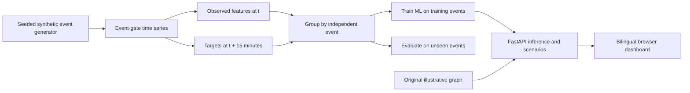

<div align="center">

# KASC Crowd Intelligence · V2

### Forecast the pressure. Route with context. Verify the evidence.

**Independent applied AI / data science engineering project**  
**Python · scikit-learn · FastAPI · Dijkstra · JavaScript · Arabic / English**


[](https://github.com/AhmedAlmufarriji/KASC-Crowd-Intelligence-V2/actions/workflows/ci.yml)

</div>

> **Integrity note:** This is an independently implemented **research and portfolio prototype** inspired by the University of Umm Al-Qura graduation project [KASC Crowd Management](https://github.com/BandarAlsarwani/KASC-Crowd-Management), completed by a team. This V2 **does not copy the original code, datasets, saved models or dashboard** and makes no claim of affiliation with King Abdullah Sports City, its operator, or real match operations. The entire data pipeline generates synthetic events. This tool must **never** be used for actual emergency, evacuation, security, venue-capacity or public route decisions.

## Project preview


> **Updated stadium view:** The route panel now renders a new illustrative stadium roof, seating tiers and football pitch. Gate and walkway geometry is **synthetic** and is not an approved stadium map. [Computer vision and stadium design notes](docs/VISION_STADIUM.md).

## Why V2 exists

The original academic prototype explored congestion prediction, processing-time estimation, and graph routing. During a repository audit, we found a number of important opportunities for an independent research extension:

- Random row-level holdouts could mix records from the same event into training and testing.
- The public dashboard used hardcoded gate cards, future tables and scenario outcomes rather than calls to the trained ML models.
- The Python and browser versions had inconsistent stadium graphs.
- The stated routing performance figures did not have a directly reproducible evaluation method.

**V2 addresses those engineering issues using a new, explicitly artificial research environment**, rather than asserting that the original model results are wrong or reusing its protected work.

## Core features

| Component | What is implemented | What it **is not** |
| --- | --- | --- |
| Predictive ML | **t+15 minute** congestion classification and queue wait regression using features observed at t | A model trained on real stadium sensors |
| Event-aware evaluation | Complete matches isolated using **GroupShuffleSplit**; dummy baselines and reproducible metrics | A claim of real-world safety performance or out-of-distribution robustness |
| API-driven dashboard | FastAPI endpoints calculate changing results for selectable events, time bins and gates | A fake "live feed" or streaming sensor integration |
| Congestion-aware routing | A **single tested topology** with 6 gates, 12 section targets, closures and weighted shortest paths | The actual stadium floor plan or certified evacuation routing |
| Operations scenarios | A deterministic fluid-queue equation recomputes the effect of adding staffed lanes | A causal estimate calibrated with operational data |
| Bilingual UI | Arabic / English dashboard with original stadium illustration and switchable route/architecture overlays | A surveyed venue map or deployed operational system |
| Computer vision | Optional OpenCV segmentation of a user-provided image, green-field candidates and image edges | Surveyed, georeferenced, or certified KASC geometry |

## Quick start

Prerequisites: **Python 3.10 or later** and a recent desktop browser. Run all commands in the cloned repository root.

**Windows PowerShell**

```powershell
py -m venv .venv
& .\.venv\Scripts\python.exe -m pip install -e ".[dev,vision]"
& .\.venv\Scripts\python.exe -m kasc_v2.training
& .\.venv\Scripts\python.exe -m kasc_v2
```

**macOS / Linux**

```bash
python3 -m venv .venv
source .venv/bin/activate
python -m pip install -e '.[dev]'
python -m kasc_v2.training
python -m kasc_v2
```

Then open **http://127.0.0.1:8000** in your browser. Interactive API documentation is at **http://127.0.0.1:8000/docs**.

> No API keys, network data feeds, paid services or external JavaScript CDNs are required. The project ships with its own generated example CSV. On first launch, if saved model artifacts are absent, the API trains models in memory from the included synthetic data. For reproducibility, run the explicit training command above.

### Try these interactions

1. In **Overview**, switch from `SIM-E001` to `SIM-E017` or move the time slider. The gate cards and model forecasts will change based on actual inference outputs.
2. Choose **Gate G1**, then **Gate G4** to compare event-specific future wait predictions with the simulation outcome.
3. In **Route intelligence**, select a gate and section, switch between **Congestion-aware** and **Shortest**, then select a walkway closure. Dijkstra recomputes the result; unreachable starts are reported honestly.
4. In **Staffing scenario**, change added staffed lanes from +0 to +3. The result is calculated from an explicit queue equation, not a preset improvement percentage.
5. Switch to **العربية** for a fully right-to-left interface.
6. On the routing tab, switch between **Route overlay** and **Roof & stands** to inspect the new stadium artwork.
7. In **Computer Vision Studio**, upload a permitted JPEG/PNG/WEBP (8 MB maximum); OpenCV processes it in memory and returns an annotated image.

## System overview



The event generator is deterministic and open to inspection; no access to the academic team's original CSV or ticket databases is needed.

## Measured example — synthetic event holdout

Results below are from one reproducible run with seed **20261027**, Python 3.13.5, scikit-learn 1.8.0 and a generated **42-event** dataset. See the saved [example metrics JSON](reports/synthetic_holdout_example.json); exact floating point results may vary across library versions.

| Held-out synthetic evaluation | Model | Baseline |
| --- | ---: | ---: |
| Congestion accuracy | **94.58%** | 68.55% |
| Congestion macro-F1 | **81.60%** | 27.11% |
| Future wait MAE | **0.86 min** | 10.86 min |

**These are _not_ validated performance metrics for King Abdullah Sports City or any live stadium.** Each synthetic gate queue follows the assumptions in [`synthetic.py`](src/kasc_v2/synthetic.py). Such data can be predictable in ways that real crowds are not.

## Files

```text
KASC-Crowd-Intelligence-V2/
├── README.md
├── pyproject.toml
├── .github/workflows/ci.yml
├── data/synthetic_gate_flow.csv           # reproducible, generated
├── reports/synthetic_holdout_example.json
├── docs/
│   ├── ARCHITECTURE.md
│   ├── DATA_CARD.md
│   ├── MODEL_CARD.md
│   ├── PROJECT_HISTORY.md
│   └── dashboard-preview.png
├── src/kasc_v2/
│   ├── synthetic.py                       # generates independent synthetic events
│   ├── training.py                        # ML training, event group holdout, baselines
│   ├── routing.py                         # unified synthetic topology + Dijkstra
│   ├── api.py                             # real inference/scenario JSON endpoints
│   └── __main__.py                        # app entrypoint
├── static/
│   ├── index.html                         # bilingual application shell
│   ├── styles.css                         # responsive visual system
│   └── app.js                             # UI interactions, SVG chart and map
├── scripts/run.py
└── tests/                                # automated unit and API checks
```

## Automated checks

```bash
python -m pytest -q
python -m compileall -q src
```

GitHub Actions runs the core and optional computer-vision tests on pushes and pull requests. Tests cover reproducibility, known future horizon, absence of target leakage in features, independent event splits, all gate-to-section pairs, closure handling, route cost invariants, FastAPI input validation, simulation claims, and scenario computations.

## Documentation

- [Architecture and API contract](docs/ARCHITECTURE.md)
- [Synthetic data card](docs/DATA_CARD.md)
- [Model card and risks](docs/MODEL_CARD.md)
- [Academic provenance and attribution](docs/PROJECT_HISTORY.md)
- [Publishing this project to your GitHub](docs/PUBLISH_TO_GITHUB.md)
- [Stadium-inspired visual design, CV experiment and limitations](docs/VISION_STADIUM.md)

## Future research directions

The next scientific steps require **authorized real observations**, externally vetted topology, a clear prediction lead time, reliable timestamps, event-level backtesting, calibration and uncertainty estimation, and safety review before using results to guide people. A live sensor feed, map, model card or attractive dashboard alone does not make a product safe for stadium operations.

---

**Author:** Ahmed Almufarriji — independent V2 development.  
**Academic inspiration:** [KASC Crowd Management](https://github.com/BandarAlsarwani/KASC-Crowd-Management), an Umm Al-Qura University team graduation project (2025–2026). The source repository's attribution and intellectual-property statements remain in force for the original work.

**Reuse:** No license grant is made by this repository README. Choose a license deliberately after reviewing ownership and any additional third-party materials.

## Visual integrity

The stadium reconstruction is original procedural SVG artwork **inspired by**, not an exact model of, King Abdullah Sports City. No official architectural or safety data is bundled. Routes, gates and sections remain synthetic and must not guide real attendees or emergency decisions.
